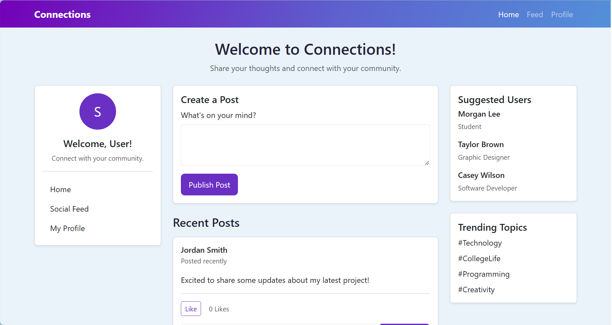

# Connections: Social Media Feed

Connections is a responsive, browser-based social media feed. Users can publish posts, toggle likes, and add comments to individual posts. The project is built with HTML, CSS, vanilla JavaScript, and Bootstrap.



## Features

- Publish posts to the top of the feed with empty-post validation.
- Like and unlike posts with an updating like count.
- Add comments beneath individual posts, with blank-comment validation.
- Render post and comment text safely as plain text.
- Browse sample posts, suggested users, and trending topics in a responsive layout.

## Technologies

- HTML5 for the page structure and forms.
- CSS3 for the custom color theme and interaction styles.
- Vanilla JavaScript for post, like, and comment behavior.
- Bootstrap 5.3.8 for responsive layout and UI components, loaded from jsDelivr.

## Project Structure

```text
social_media_feed/
|-- index.html
|-- css/
|   `-- style.css
|-- js/
|   `-- script.js
|-- img/
|   |-- connections_webpage.png
|   |-- copilot1.png
|   |-- copilot2.png
|   |-- copilot3.png
|   |-- copilot4.png
|   |-- copilot5.png
|   |-- copilot6.png
|   |-- copilot7.png
|   `-- copilot8.png
|-- README.md
`-- REFLECTION.md
```

## Installation

1. Download or clone the project and open its directory.
2. No package installation or build step is required.
3. Keep an internet connection available so the page can load Bootstrap from the CDN.

## Run the Application

### Visual Studio Code Live Server

1. Open the project directory in Visual Studio Code.
2. Open `index.html` and select **Go Live** (the Live Server extension must be installed).
3. The app opens in your browser.

### Python HTTP Server

From the project directory, run:

```bash
python -m http.server 8000
```

Then visit [http://localhost:8000](http://localhost:8000). Stop the server with `Ctrl+C`.

## Usage

1. Type a message in **What's on your mind?** and select **Publish Post**. The post appears at the top of the feed as **User**.
2. Select **Like** to add a like. Select it again to remove that like.
3. Use the comment field beneath any post to add a comment to that post.
4. Empty and whitespace-only posts or comments are rejected.

## Data and Limitations

This is a front-end demonstration with no account system, backend, or persistent storage. New posts, comments, and like changes exist only in the current page session and reset when the page is reloaded. New posts and comments use the fixed display name **User**.