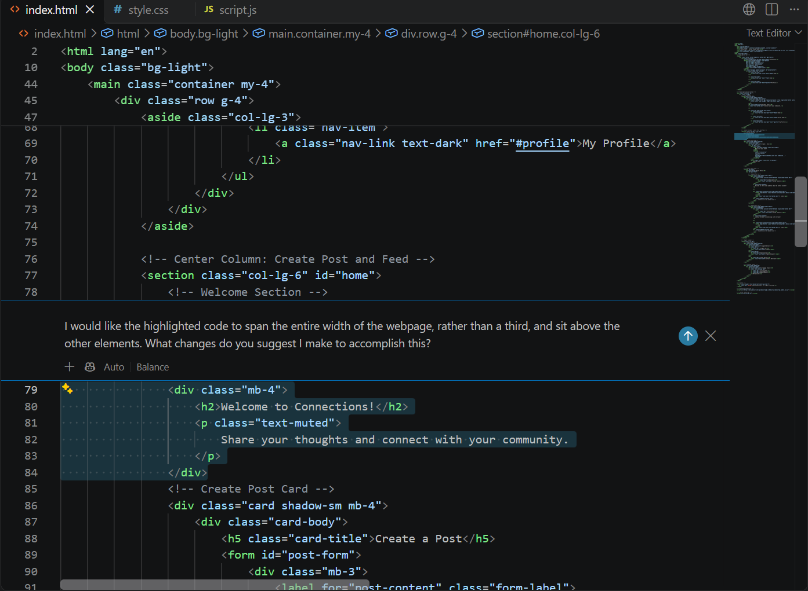
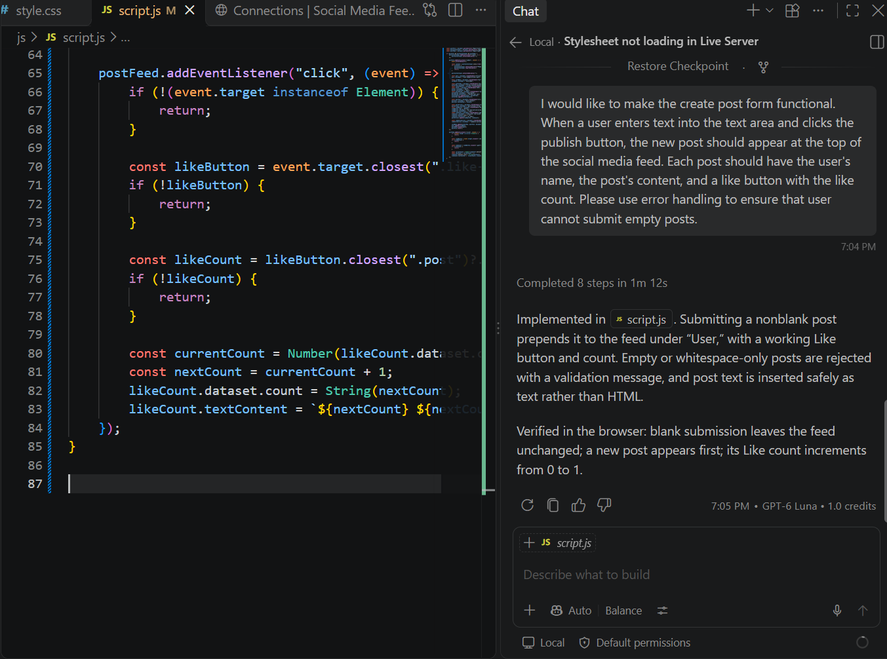
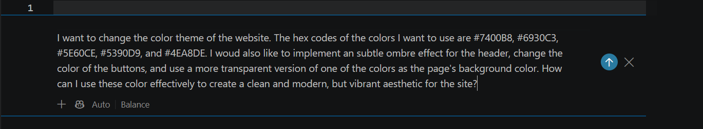
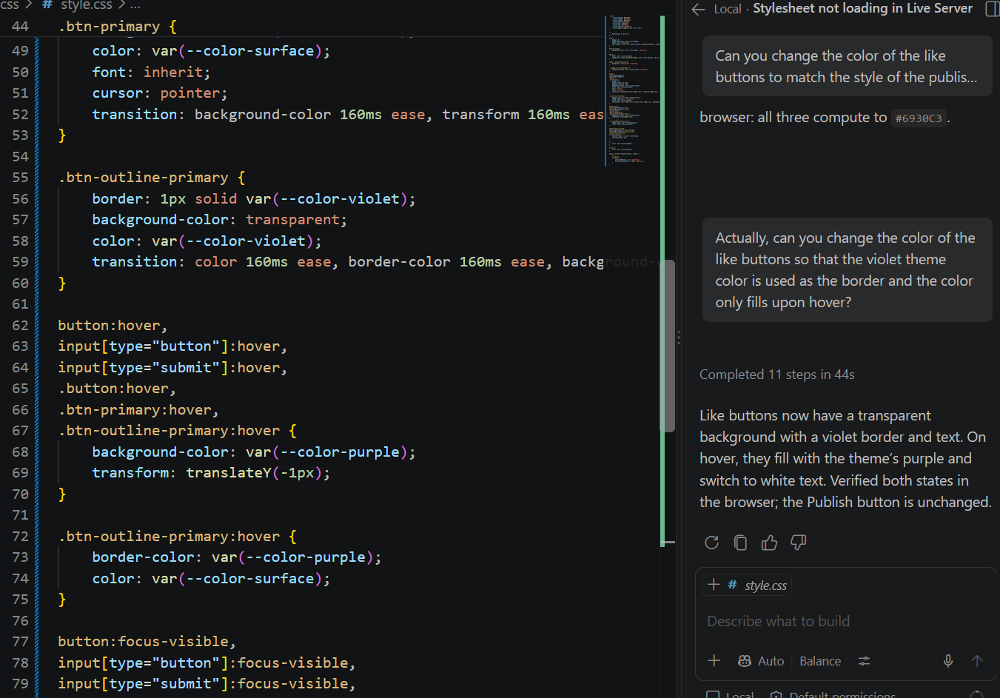
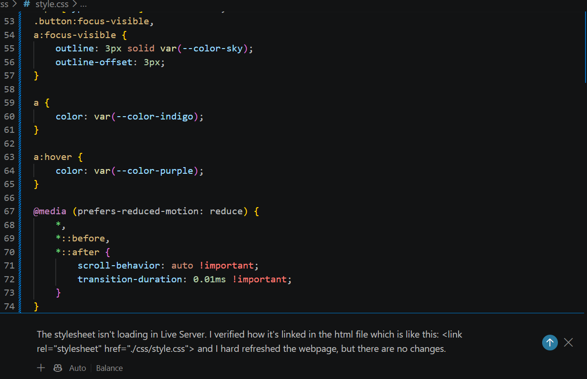
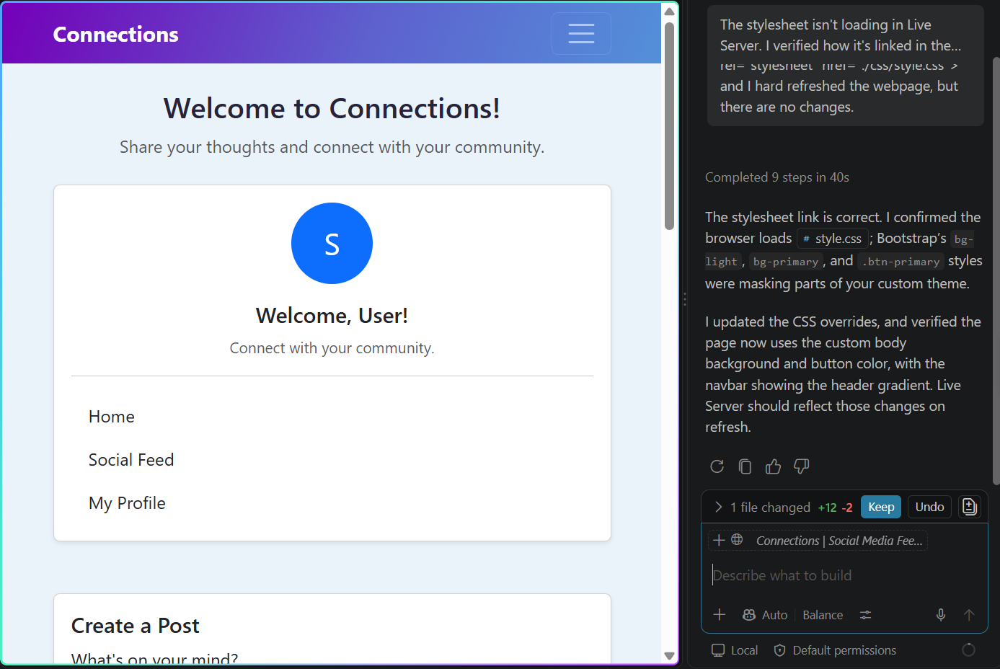
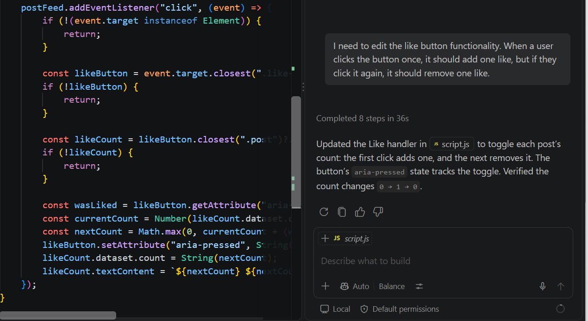
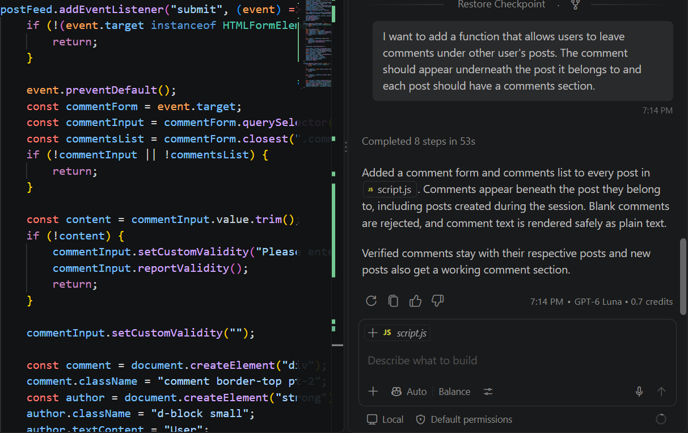

# Copilot Reflection

## What did Copilot help you build? How did you break down the problem?
The project I decided to complete with the help of GitHub Copilot was a social media feed. I approached this project by first creating the basic layout with placeholder sections and IDs prepared for the features I wanted to implement later. When working with Copilot, I broke down each interaction into one feature or design change I wanted to implement rather than asking it to build the entire application at once. For example, I started by improving the layout and styling of the page before moving on to implementing the functionality of the post form, like button, and comment sections. This allowed me to focus on one part of the application at a time and make adjustments before moving on to the next feature.

### Changing Title Layout with Copilot

### Making the Post Form Functional with Copilot

## How did your approach to asking questions change as you worked?
As I worked with Copilot, my approach to asking questions changed as I began to better understand how the output could change depending on the amount of context provided. Initially, my prompts were more focused on describing the general changes I wanted to make. However, as I became more familiar with how Copilot worked, I started providing more specific instructions about the appearance and functionality I wanted. I also learned that providing context about my existing code helped Copilot make changes that better aligned with my project instead of generating something entirely new. This made it easier to build on the existing application and make adjustments without having to start over.

### Creating the Site's Theme with Copilot

### Modifying Button Styling with Copilot

## What parts of the development process with GitHub Copilot surprised you?
I think that the most surprising part of the development process with Copilot was how advanced its functionality is. I had never worked with it before, so seeing its ability to read the files in my project, make appropriate changes based on what I was trying to accomplish, and help troubleshoot problems was very interesting. I was also surprised by how it could work with different parts of my project, such as HTML, CSS, and JavaScript, while keeping the changes connected to the overall application. This made it easier to implement features that involved multiple files without having to manually make every change myself.

### Troubleshooting Stylesheet Loading Error with Copilot

### Copilot's Solution to Loading Error

## What did you learn about the technology you used that you didn't before?
Through this project, I learned more about how HTML, CSS, Bootstrap, and JavaScript work together to create an interactive website. I had previously worked with HTML and CSS, but this project gave me more experience using Bootstrap classes to organize page layouts and style different elements. I also learned more about how JavaScript can be used to make a webpage interactive by allowing users to submit information, update content, and interact with individual posts. For example, implementing the like button and comment sections helped me better understand how JavaScript can respond to user actions and update the content displayed on a page.

### Implementing the Like Button with Copilot

### Adding a Comment Feature for Each Post with Copilot

## What would you do differently if you had to build this again?
If I had to build this application again, I think I would spend more time in the planning stage. This would help me determine exactly what I want to accomplish with the site and allow me to ask more detailed questions to use Copilot more efficiently. I would also consider outlining the functionality of each feature before beginning development, so I have a better understanding of how the different parts of the application need to work together. Overall, I think having a more detailed plan from the beginning would make the development process more organized and help me get more out of my interactions with Copilot.